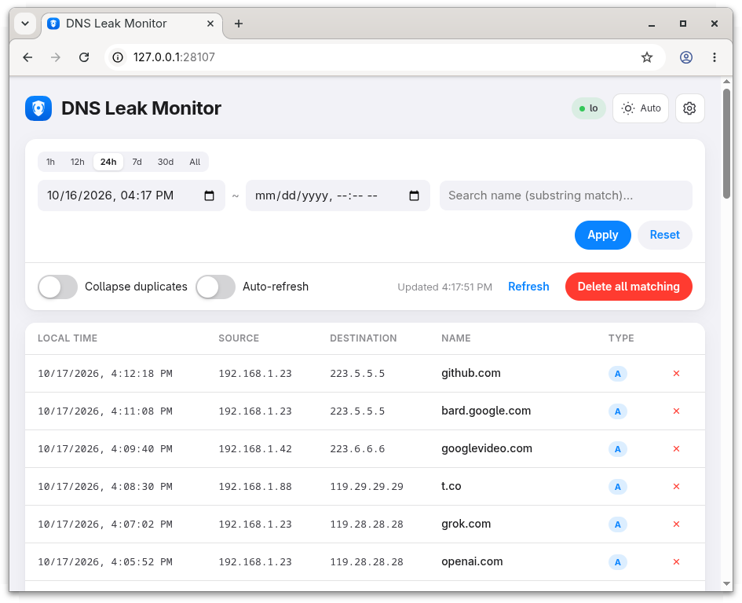

<h1 align="center">
  
  DNS Leak Monitor
</h1>

<p align="center"><a href="README.md">中文</a> · English</p>

<p align="center">
  Monitor outbound plaintext DNS queries on Linux
</p>

<p align="center">
  
</p>

> [!WARNING]
> **Prerequisite**
>
> This tool is intended for environments where outbound plaintext <code>:53</code> traffic is occasional.
> Do not use it for a DNS direct-out setup where most queries go straight to upstream resolvers: the monitor will continuously record a large volume of DNS queries, which is outside this tool's intended use.

## Table of contents

- [Table of contents](#table-of-contents)
- [1. The problem it solves](#1-the-problem-it-solves)
- [2. Installation](#2-installation)
  - [2.1 Docker Compose (recommended)](#21-docker-compose-recommended)
  - [2.2 systemd service](#22-systemd-service)
  - [2.3 Build from source](#23-build-from-source)
- [3. Recommended workflow](#3-recommended-workflow)
- [4. Repository layout](#4-repository-layout)
- [5. Development](#5-development)

## 1. The problem it solves

Your local DNS service may already turn normal requests into DoH, or send DNS requests through a proxy, but DNS leaks may still occur:

- personal configuration errors;
- an application chooses a public resolver directly;
- a container, VM, or network namespace has no specified network path;
- a device or client temporarily falls back to plaintext DNS.

At this point, you need to know whether anything leaked and what leaked before you can harden the configuration. `tcpdump` is commonly used for temporary packet-capture tests, but it cannot stay resident, record, and filter. That is why this project, `dns-leak-monitor`, provides these functions through a persistent service.

## 2. Installation

### 2.1 Docker Compose (recommended)

You need Docker Engine on Linux and permission for host networking plus `NET_RAW` and `NET_ADMIN`. Create `compose.yml`:

```yaml
# Linux host; run: docker compose up -d
services:
  dns-leak-monitor:
    image: ghcr.io/ctxinf/dns-leak-monitor:latest
    network_mode: host
    user: "0:0"
    cap_drop:
      - ALL
    cap_add:
      - NET_RAW
      - NET_ADMIN
    security_opt:
      - no-new-privileges:true
    read_only: true
    restart: unless-stopped
    stop_grace_period: 10s
    volumes:
      # - ./config:/etc/dns-leak-monitor:Z
      - dns-leak-monitor-data:/var/lib/dns-leak-monitor
    logging:
      driver: json-file
      options:
        max-size: "10m"
        max-file: "3"

volumes:
  dns-leak-monitor-data:
    name: dns-leak-monitor-data
```

Start the service:

```bash
docker compose up -d
```

If you need to change the configuration, create `config/config.toml` alongside `compose.yml` and uncomment the configuration-directory mount above. Set `interface` to the host interface that carries the DNS traffic. The configuration directory is bind-mounted into the container, so interface and exclusion changes made by the console survive container recreation.

View logs or stop the service:

```bash
docker compose logs -f
docker compose down
```

### 2.2 systemd service

Use this on a Linux host with Rust/Cargo, the libpcap development package, and systemd. The script builds the release binary, creates a dedicated service user, installs the unit, and starts it:

```bash
git clone https://github.com/ctxinf/dns-leak-monitor.git
cd dns-leak-monitor
IFACE=eth0 ./deploy/systemd/install-service.sh
```

Replace `eth0` with the interface that actually carries outbound DNS traffic. You can omit `IFACE` and select an interface interactively. Run the script as your normal user; it asks for sudo only during installation.

After installation:

```bash
# Open locally
http://127.0.0.1:28107

# On a remote host: create a tunnel from your local machine,
# then open the same URL locally
ssh -L 28107:127.0.0.1:28107 user@your-server
```

After editing `/etc/dns-leak-monitor/config.toml`, reload for exclusion-list changes. Restart for interface, bind-address, or database-path changes:

```bash
sudo systemctl reload dns-leak-monitor
sudo systemctl restart dns-leak-monitor
journalctl -u dns-leak-monitor -f
```

### 2.3 Build from source

```bash
cargo build --release --locked
```

You need stable Rust and the libpcap development package. The binary is written to `target/release/dns-leak-monitor`. For a manual deployment, use [`config.example.toml`](config.example.toml), [`deploy/systemd/dns-leak-monitor.service`](deploy/systemd/dns-leak-monitor.service), and the installer script as references.

## 3. Recommended workflow

1. Confirm that your local DNS service handles the main DNS entry point and uses DoH upstream.
2. You can add confirmed-good, high-volume names or reverse-DNS domains to `exclude`, such as `in-addr.arpa` and `ip6.arpa`.
3. Review the remaining `:53` requests and trace each source address to the relevant process, container, VM, or client configuration.
4. Run one deliberate test query to verify the capture path, then delete the test record. Keep real leads until the investigation is complete.

Exclusions use DNS suffix matching: `example.com` also excludes `a.example.com`. Records are retained for 90 days by default. The database and logs may contain hostnames and addresses, so apply access controls and backup rules appropriate for your environment.

## 4. Repository layout

- `src/`: capture, DNS parsing, exclusion, SQLite storage, and web console.
- `deploy/systemd/`: systemd unit and installer.
- `deploy/docker/`: Dockerfile, Compose file, and container defaults.
- `config.example.toml`: host deployment configuration example.

## 5. Development

```bash
cargo build
cargo test
cargo clippy --all-targets -- -D warnings
```
